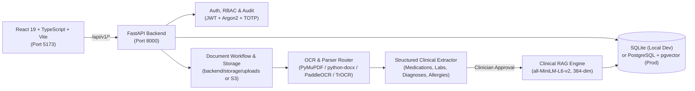

# CareOS — Healthcare Operations, Clinical OCR & Grounded Clinical RAG Platform

CareOS is an enterprise-grade healthcare operations and clinical intelligence platform with full bilingual (**English & Arabic**) support. It combines multi-tenant hospital workflow management, role-based access control (RBAC), clinical document ingestion, bilingual OCR & structured candidate extraction, and a hallucination-resistant **Clinical RAG (Retrieval-Augmented Generation)** pipeline.

---

## 1. Project Overview

CareOS provides:
- **Multi-Tenant Clinical Operations**: Patient records, encounters, vitals, allergies, diagnoses, medications, lab results, appointments, tasks, care plans, billing/invoices, and audit logs.
- **Document Workflow & Bilingual OCR**: Upload PDF, DOCX, PNG/JPG, or plain-text clinical documents (`<= 25 MB`). Automatic routing across native PDF/DOCX parsers (`PyMuPDF` / `pypdf` / `python-docx`), printed OCR (`PaddleOCR` for Arabic & English), and optional handwritten OCR (`TrOCR`).
- **Structured Clinical Extraction & Clinician Review**: Automatically extracts structured clinical candidates (medications with strength/dosage/frequency/duration, lab results with units/reference ranges, diagnoses, allergies, clinical findings, and follow-up instructions) while flagging uncertain/handwritten tokens for human verification before indexing.
- **Grounded Clinical RAG**: Indexes **only clinician-approved (`review_status="approved"`) and active (`deleted_at IS NULL`)** documents using a local 384-dimensional `SentenceTransformer` (`sentence-transformers/all-MiniLM-L6-v2`) embedding model, enforcing strict tenant/patient isolation, negation/uncertainty preservation, and sentence-level citation verification.

---

## 2. Architecture Overview



---

## 3. Repository Structure

```text
newcareos-main/
├── .env.example                 # Root environment configuration template
├── .gitignore                   # Excludes .env, .venv, node_modules, local DBs, uploads
├── docker-compose.yml           # PostgreSQL (pgvector:pg16) + Redis + FastAPI stack
├── package.json                 # Frontend dependencies & npm scripts
├── playwright.config.ts         # End-to-end Playwright test configuration
├── vite.config.ts               # Vite dev server & /api/v1 proxy to 127.0.0.1:8000
├── scripts/
│   ├── setup.ps1                # One-command Windows environment setup script
│   ├── check.ps1                # Non-destructive health, DB, OCR, RAG & TS check script
│   └── start.ps1                # Launches Backend (8000) and Frontend (5173) on Windows
├── src/                         # React 19 + TypeScript frontend source
│   ├── api/                     # Typed API client & services (services.ts, client.ts)
│   ├── components/              # Clinical UI modules (DocumentWorkflow, ClinicalKnowledgeSearch, etc.)
│   ├── context/                 # Auth, Language (EN/AR RTL), and Theme providers
│   └── pages/                   # Application views and role dashboards
└── backend/                     # FastAPI Python backend
    ├── .env.example             # Backend environment configuration template
    ├── Dockerfile               # Production container image with OCR system libraries
    ├── alembic.ini              # Alembic migration configuration
    ├── pyproject.toml           # Python project metadata & pytest configuration
    ├── requirements.txt         # Pinned/bounded Python dependencies
    ├── migrations/              # Alembic schema migrations (0001 through 0018)
    ├── app/
    │   ├── main.py              # FastAPI application entrypoint & middleware
    │   ├── api.py               # Core REST endpoints (/auth, /patients, /documents, /rag, /system)
    │   ├── config.py            # Portable Pydantic settings & path normalization
    │   ├── db.py                # Async SQLAlchemy engine & session management
    │   ├── models.py            # SQLAlchemy ORM models (including DocumentChunk 384-dim vector)
    │   ├── ocr.py               # Bilingual structured clinical candidate extraction
    │   ├── storage.py           # Local filesystem (backend/storage/uploads) & S3 storage service
    │   └── rag/                 # Clinical RAG subsystem
    │       ├── parsers/         # PDF, DOCX, and Image parsers -> UnifiedDocument
    │       ├── ocr/             # Printed (PaddleOCR) & Handwriting (TrOCR) OCR engines + router
    │       ├── chunker.py       # Overlapping clinical page chunker
    │       ├── embeddings.py    # Local SentenceTransformer (all-MiniLM-L6-v2, 384-dim)
    │       ├── store.py         # Dual-backend vector store (SQLite cosine + pgvector)
    │       ├── llm.py           # Extractive synthesis + optional external LLM + citation verifier
    │       └── pipeline.py      # 3-mode RAG pipeline (guideline_only, patient_only, mixed)
    └── tests/                   # Backend automated test suites (pytest)
```

---

## 4. System Requirements

| Requirement | Minimum / Recommended Version | Notes |
| :--- | :--- | :--- |
| **Operating System** | Windows 10 / Windows 11 (64-bit) | Linux and macOS also supported via standard venv / Docker |
| **Python** | **Python 3.11 or 3.12 (64-bit)** | Ensure `python` and `pip` are added to `PATH` |
| **Node.js & npm** | **Node.js 20 LTS+** (`npm 10+`) | Required for Vite React 19 frontend |
| **Git** | Git 2.40+ | For version control |
| **Disk Space** | ~4 GB free | For `.venv`, `node_modules`, PaddleOCR models, and HuggingFace embedding cache |
| **Docker Desktop** *(Optional)* | Docker Engine 24+ / Compose v2 | Only required if running the PostgreSQL (`pgvector`) + Redis container stack |

> **OCR & Native Libraries Note (Windows)**:
> PDF parsing (`PyMuPDF` / `pypdf`), DOCX parsing (`python-docx`), and image handling (`Pillow` / `opencv-python-headless`) work out of the box via prebuilt Windows wheels—no external Poppler or Tesseract installer is required.

---

## 5. Quick Start for Windows (PowerShell)

Open **PowerShell** inside the `newcareos-main` folder and run:

```powershell
# 1. Automated setup (creates .venv, installs Python & Node packages, copies .env.example -> .env, warms up RAG model)
powershell -ExecutionPolicy Bypass -File scripts/setup.ps1

# 2. Verify environment readiness (checks DB, OCR, 384-dim RAG embeddings, health endpoints, and TypeScript)
powershell -ExecutionPolicy Bypass -File scripts/check.ps1

# 3. Start Backend (http://127.0.0.1:8000) and Frontend (http://127.0.0.1:5173)
powershell -ExecutionPolicy Bypass -File scripts/start.ps1
```

Once started:
- **Frontend UI**: [http://127.0.0.1:5173](http://127.0.0.1:5173)
- **Backend API Root**: [http://127.0.0.1:8000](http://127.0.0.1:8000)
- **Interactive Swagger UI**: [http://127.0.0.1:8000/docs](http://127.0.0.1:8000/docs)
- **Health Check**: [http://127.0.0.1:8000/api/v1/healthz](http://127.0.0.1:8000/api/v1/healthz)
- **System & OCR/RAG Status**: [http://127.0.0.1:8000/api/v1/system/status](http://127.0.0.1:8000/api/v1/system/status)

---

## 6. Detailed Backend Setup (Manual Step-by-Step)

If you prefer to set up the backend manually in PowerShell from the repository root (`newcareos-main`):

```powershell
# 1. Create and activate the virtual environment at the repository root
python -m venv .venv
.\.venv\Scripts\Activate.ps1

# 2. Upgrade pip and install backend dependencies
python -m pip install --upgrade pip
pip install -r backend/requirements.txt

# 3. Create your local environment file from the template
if (-not (Test-Path backend/.env)) { Copy-Item backend/.env.example backend/.env }

# 4. Run database migrations (creates/updates backend/careos-local.db by default)
Push-Location backend
alembic upgrade head

# 5. Start the FastAPI server on port 8000
$env:PADDLE_PDX_DISABLE_MODEL_SOURCE_CHECK = "True"
python -m uvicorn app.main:app --host 127.0.0.1 --port 8000 --reload
Pop-Location
```

---

## 7. Detailed Frontend Setup (Manual Step-by-Step)

In a second PowerShell terminal at the repository root (`newcareos-main`):

```powershell
# 1. Copy root .env template if not present
if (-not (Test-Path .env)) { Copy-Item .env.example .env }

# 2. Install Node.js dependencies
npm.cmd install

# 3. Verify TypeScript compilation
npm.cmd run typecheck

# 4. Start the Vite development server on port 5173
npm.cmd run dev -- --host 127.0.0.1 --port 5173
```

> **Note on Vite API Proxy**: By default, `vite.config.ts` proxies all `/api/v1/*` requests from `http://127.0.0.1:5173` to `http://127.0.0.1:8000`. Leave `VITE_API_BASE_URL` empty in `.env` during local development so browser requests use the built-in proxy without CORS issues.

---

## 8. Environment Variables Reference

Both `.env` (in the repo root) and `backend/.env` are automatically loaded by `backend/app/config.py`.

| Variable | Default (Dev) | Required? | Description |
| :--- | :--- | :--- | :--- |
| `APP_ENV` | `development` | Yes | `development`, `staging`, or `production` |
| `API_PREFIX` | `/api/v1` | Yes | REST API route prefix |
| `DATABASE_URL` | `sqlite+aiosqlite:///./careos-local.db` | Yes | Async SQLAlchemy URL (`sqlite+aiosqlite` in dev, `postgresql+asyncpg` in prod) |
| `SECRET_KEY` | `development-only-change-this-secret` | Prod: Yes | JWT & session signing key (must be `>= 32` chars in production) |
| `ACCESS_TOKEN_MINUTES` | `30` | No | JWT access token expiration window in minutes |
| `STORAGE_BACKEND` | `filesystem` | Yes | `filesystem` (stores under `backend/storage/uploads`) or `s3` |
| `STORAGE_LOCAL_ROOT` | `storage/uploads` | No | Local upload folder (relative paths resolve inside `backend/`) |
| `OCR_DEFAULT_ENGINE` | `printed` | No | `printed` (PaddleOCR), `handwriting`, or `auto` |
| `OCR_LANGUAGE` | `ar` | No | Default PaddleOCR language (`ar` or `en`) |
| `HANDWRITING_OCR_MODEL` | `sherif1313/Arabic-handwritten-OCR-4bit-Qwen2.5-VL-3B-v3` | No | Optional Vision-Language handwriting OCR model |
| `HANDWRITING_OCR_DEVICE` | `auto` | No | Device for handwriting OCR (`auto`, `cuda`, or `cpu`) |
| `RAG_EMBEDDING_MODEL` | `sentence-transformers/all-MiniLM-L6-v2` | Yes | Local 384-dim embedding model |
| `RAG_ALLOW_MODEL_DOWNLOAD` | `true` (in `.env.example`) | Yes (1st run) | Allows caching `all-MiniLM-L6-v2` (~90 MB) on first run on a new machine |
| `VECTOR_TOP_K` / `RAG_TOP_K` | `8` | No | Maximum number of chunks retrieved per RAG query |
| `RAG_RELEVANCE_THRESHOLD` | `0.55` | No | Minimum cosine similarity (`0.0` to `1.0`) for clinical evidence retrieval |
| `LEGACY_RAG_DB_PATH` | *(empty)* | No | Optional path to a read-only `careos_rag.db` SQLite file for bulk guideline import |
| `OPENAI_API_KEY` / `GEMINI_API_KEY` / `AI_API_KEY` | *(empty)* | No | Optional external LLM API key. When empty, CareOS uses deterministic extractive synthesis |
| `VITE_PORT` | `5173` | No | Vite dev server port |
| `VITE_API_BASE_URL` | *(empty)* | No | Frontend API base URL override (leave empty to use Vite proxy) |

---

## 9. Database Setup and Migrations

- **Local Development (Default)**: Uses SQLite (`sqlite+aiosqlite:///./careos-local.db`), resolved relative to `backend/`. When the FastAPI server starts in non-production mode, `init_db()` automatically ensures all tables exist (`Base.metadata.create_all`).
- **Alembic Migrations**: Located in `backend/migrations/versions/` (`0001_enterprise_schema.py` through `0018_clinical_rag_document_chunks.py`).
  To apply migrations manually against your configured `DATABASE_URL`:
  ```powershell
  Push-Location backend
  ..\.venv\Scripts\python.exe -m alembic upgrade head
  Pop-Location
  ```
- **Demo Accounts (Development Mode)**:
  On the login screen, you can register a new organization owner or use the built-in demo login endpoint (`/api/v1/auth/demo-login`) for roles such as `doctor` (`doctor.demo` / `Doctor@123`), `admin` (`admin.demo` / `Admin@123`), `nurse` (`nurse.demo` / `Nurse@123`), or `patient` (`patient.demo` / `Patient@123`).

---

## 10. OCR, RAG, and AI Configuration

### How OCR Works
1. **PDF & DOCX Native Extraction**: Digital PDFs are parsed with `PyMuPDF` (`fitz`) and `pypdf` fallback; `.docx` files use `python-docx`.
2. **Printed OCR (`PaddleOCR`)**: Scanned PDFs and images (`.png`, `.jpg`) are processed by `PaddleOCR` supporting both English and Arabic text lines.
3. **Handwriting OCR (`Qwen2.5-VL` / Transformers, Optional)**: Lazy-loaded only when `ocr_engine="handwriting"` is explicitly requested.
4. **Structured Candidate Organization**: Raw OCR text is normalized by `extract_structured_clinical_candidates` in `backend/app/ocr.py` into medications, labs, diagnoses, allergies, findings, and follow-up items, with explicit `[NEEDS_REVIEW]` flags for uncertain/handwritten lines.

### How Clinical RAG Works (Offline-Ready by Default)
- **Local Embeddings**: Uses `sentence-transformers/all-MiniLM-L6-v2` (384 dimensions). On a new machine, keep `RAG_ALLOW_MODEL_DOWNLOAD=true` in `.env` for the first run (or run `scripts/setup.ps1`) so HuggingFace caches the ~90 MB model locally. Once cached, it runs 100% offline.
- **Approval Gate**: Uploaded documents start in `review_status="pending_review"`. Only when a clinician clicks **Approve & Index** (`POST /api/v1/documents/{id}/review`) are the document's chunks embedded and stored in `document_chunks`. Rejected or soft-deleted documents are immediately purged from the vector store.
- **No External LLM Key Required**: When no `OPENAI_API_KEY`, `GEMINI_API_KEY`, or `AI_API_KEY` is configured, the RAG pipeline uses deterministic **Extractive Evidence Synthesis** with strict sentence-level citation verification (`[Source: <filename>, Page <n>]`). If an external key is configured, the pipeline uses the external LLM while still enforcing post-generation citation verification and refusal on insufficient evidence.

---

## 11. Running the Full Stack Locally

```powershell
powershell -ExecutionPolicy Bypass -File scripts/start.ps1
```

### End-to-End Functional Verification Flow in the UI
1. Open [http://127.0.0.1:5173](http://127.0.0.1:5173) and sign in (or register a new clinic account).
2. Navigate to **Patients** and select or create a patient.
3. Open **Documents** (`DocumentWorkflow`):
   - Upload a clinical PDF, DOCX, or prescription image.
   - Inspect the **Structured Clinical Summary** cards (Document Metadata, Medications, Lab Results, Diagnoses, Allergies, Clinical Findings) and the **Raw OCR Text** preview.
   - Click **Approve** to index the document into the Clinical RAG vector store.
4. Open **Clinical Knowledge Search** (`ClinicalKnowledgeSearch`):
   - Ask a clinical question about the approved document or patient.
   - Verify that the returned answer is grounded, displays `[Source: ..., Page ...]` citations, and lists the retrieved chunks with similarity scores.

---

## 12. Running with Docker

To run PostgreSQL 16 (`pgvector`), Redis 7, and the FastAPI backend in Docker containers:

```powershell
# Build and start PostgreSQL (pgvector), Redis, and the CareOS API
docker compose up --build -d

# Check container health and logs
docker compose ps
docker compose logs -f api
```

When running the backend in Docker on port `8000`, you can still run the Vite frontend locally on port `5173` via `npm.cmd run dev`.

---

## 13. Running Tests and Verification

All automated tests use isolated temporary SQLite databases and **never modify or delete** your local `careos.db` or `careos-local.db`.

```powershell
# 1. Run the complete environment & readiness check script
powershell -ExecutionPolicy Bypass -File scripts/check.ps1

# 2. Run Backend Health, OCR, Parser, and Clinical RAG test suites
Push-Location backend
$env:PADDLE_PDX_DISABLE_MODEL_SOURCE_CHECK = "True"
..\.venv\Scripts\python.exe -m pytest tests/test_health.py tests/test_ocr_and_parsers.py tests/test_clinical_rag.py -q
Pop-Location

# 3. Run Frontend TypeScript validation & Production build check
npm.cmd run typecheck
npm.cmd run build
```

---

## 14. Common Issues and Troubleshooting

| Symptom / Error | Cause | Fix |
| :--- | :--- | :--- |
| **`Local embedding model 'sentence-transformers/all-MiniLM-L6-v2' is not available in the local HuggingFace cache`** | Running on a fresh machine for the first time with `RAG_ALLOW_MODEL_DOWNLOAD=false`. | Set `RAG_ALLOW_MODEL_DOWNLOAD=true` in `.env` / `backend/.env` or run `powershell -ExecutionPolicy Bypass -File scripts/setup.ps1` once while connected to the internet. |
| **`PowerShell ExecutionPolicy blocks scripts/setup.ps1`** | Windows default execution policy restricts `.ps1` scripts. | Run with `powershell -ExecutionPolicy Bypass -File scripts/setup.ps1`. |
| **`Port 8000 or 5173 is already in use`** | An existing `uvicorn` or `node` process is already listening. | Stop the existing process or pass custom ports: `powershell -ExecutionPolicy Bypass -File scripts/start.ps1 -BackendPort 8001 -FrontendPort 5174`. |
| **Uploaded document does not appear in RAG search results** | Unapproved (`pending_review`), `rejected`, or soft-deleted documents are excluded from RAG by design for clinical safety. | Open **Documents**, select the document, and click **Approve** so it is indexed into `document_chunks`. |
| **Slow startup when importing PaddleOCR** | PaddleX checks remote model host connectivity on import. | Set `$env:PADDLE_PDX_DISABLE_MODEL_SOURCE_CHECK="True"` (automatically set by `scripts/start.ps1` and `scripts/check.ps1`). |
| **CORS error in browser** | Accessing the frontend via an origin not listed in `CORS_ORIGINS`. | Ensure you access `http://127.0.0.1:5173` or `http://localhost:5173`, and leave `VITE_API_BASE_URL` empty in `.env` so Vite proxies `/api/v1`. |

---

## 15. Team Handoff Checklist

Before zipping, copying, or pushing `newcareos-main` to share with another developer:

- [ ] **Do NOT include `.env` or `backend/.env`** — teammates should generate their own from `.env.example` via `scripts/setup.ps1`.
- [ ] **Do NOT include `.venv/`, `.venv-1/`, or `node_modules/`** — virtual environments contain machine-specific absolute paths in launcher shims and must be created on the target machine via `scripts/setup.ps1`.
- [ ] **Do NOT include local SQLite `.db` files (`backend/*.db`) or `backend/storage/uploads/`** — these contain local runtime state.
- [ ] On the receiving Windows machine, the developer only needs **Python 3.11/3.12**, **Node.js 20+**, and **PowerShell**, then runs:
  1. `powershell -ExecutionPolicy Bypass -File scripts/setup.ps1`
  2. `powershell -ExecutionPolicy Bypass -File scripts/check.ps1`
  3. `powershell -ExecutionPolicy Bypass -File scripts/start.ps1`

---

## 16. Recent Platform Capabilities & Enhancements

### 16.1. IT Administrator Direct User Provisioning & Revocation
- **Direct Account Creation with Immediate Password**: IT Administrators (`it_admin`, `admin`, `hospital_director`) can create team members directly via `POST /api/v1/team/users` with explicit credentials (`full_name`, `email`, `password`, `role`, `department`) without requiring email invitation tokens.
- **Immediate Login**: Newly provisioned staff can immediately authenticate via `/api/v1/auth/login`.
- **Soft Deletion & Instant Session Revocation**: Calling `DELETE /api/v1/team/users/{user_id}` marks the user as deleted (`deleted_at`), purges active sessions from `AuthSession`, and immediately revokes all bearer tokens (`401 Unauthorized`).
- **Interactive Management UI**: Direct action buttons and confirmation dialogs built into `StaffManagement.tsx` and `TeamAudit.tsx`.

### 16.2. Egyptian Colloquial Voice Assistant (VoiceTut-TTS)
- **Cairo Colloquial Dialect (اللهجة المصرية الدارجة)**: All patient voice interactions are processed through `to_egyptian_colloquial_speech`, converting standard formal Arabic into authentic, natural Egyptian phrasing (`"أهلاً بحضرتك في كير أو إس"`, `"ألف سلامة عليك"`).
- **Authentic VoiceTut-TTS Neural Speakers**: Speech generation is powered by `mohammedaly22/VoiceTut-TTS`, featuring authentic Egyptian clinical voices:
  - **محمد (Mohammed)**: Calm, warm, and professional Egyptian male tone (`spk_06_male`).
  - **مريم (Mariam)**: Gentle, clear, and reassuring Egyptian female tone (`spk_15_female`).
- **Complete Elimination of Robotic Mechanical Voices**: Legacy robotic voices are completely purged from the platform in favor of authentic colloquial VoiceTut models (Mohammed & Mariam).

### 16.3. Telegram Automated Patient Follow-up
- **Automated Delivery**: Trigger clinical reminders, test results, and post-visit follow-up questions via `POST /api/v1/integrations/telegram/send-followup`.
- **Deep-Link Bot Activation**: Direct bot link (`https://t.me/CareOS_HealthBot?start={PATIENT_ID}`) embedded inside the Patient Portal Messages tab.
- **Webhook Handlers**: `POST /api/v1/integrations/telegram/webhook` to capture patient replies and map them back to clinical encounters.

### 16.4. Modernized UI/UX Suites
- **Department Details Modal (`DepartmentOverview.tsx`)**: 2x2 metric grid (Bed Capacity, On-duty Physicians, Nursing Staff, Daily Follow-ups), clinical supervisor details, and balanced action buttons.
- **Account & Security Dashboard (`AccountPage.tsx`)**: Modern profile hero banner, status badge, workplace affiliation card, and security controls with prominent sign-out.
- **Patient Portal Messages Tab (`PatientPortal.tsx`)**: Telegram follow-up card, bidirectional chat bubbles, and prescription viewing with QR codes.

